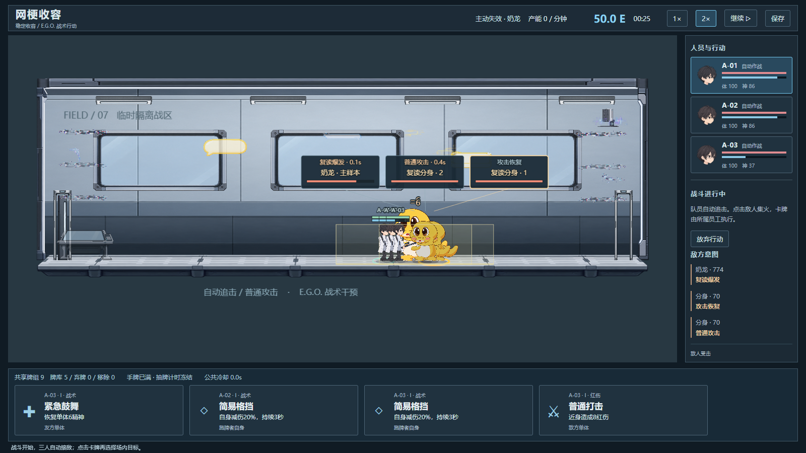

# 网梗收容：奶龙失效

## 当前默认：v0.3 稳定收容与实时卡牌战斗

战斗卡牌已接入18张独立生成插图、竖版E.G.O.卡框、持卡员工/目标高亮、出牌与专属命中特效，以及全卡由上到下恢复颜色的冷却。需求Excel与完整提示词在 `outputs/cards-v1/`、`art-production/cards-v1/`；[卡牌美术与实机验收](docs/CARDS_ART_V1_ACCEPTANCE.md)。DEV `?cardArtPreview=N01`（T/N01–N05）为不读写存档的调试预览。

外勤已接入五张独立生成场景：奶龙商场亲子区、耄耋旧社区、大狗宠物广场、叮咚鸡地铁广播区、咕咕嘎嘎母婴儿童角。各有独立污染表现，暂停同步冻结；室内主动失效仍在设施内。资源在 `public/art/field-v1/`，详见 [五图与实机验收](docs/FIELD_ART_V1_ACCEPTANCE.md)。奶龙开局已收容，商场可用DEV `?fieldPreview=N01`查看；N01–N05预览明确标记且不访问存档，生产包忽略该参数。

按用户提供的玩法补丁改为“稳定产能→主动失效挑战→三人自动接敌/普攻＋九张共享卡→升阶→外勤抓捕”。保留大型二维设施、人物v3与五物美术。默认不再自动失效、不再通过三日指标推进，旧主管技能入口由武器卡牌替代。完整操作顺序、状态边界与本轮修复见 [v0.3 游戏流程书](docs/GAMEPLAY_FLOW_BOOK_V03.md)。

奶龙 I→II 与耄耋首次抓捕已实际连续玩通；最新完整流程1×实测分别16.95和13.95模拟秒。五物对应装备的56场引擎模拟为12.3–18.8秒，但后三物尚未逐一浏览器实玩全部阶级。已修复重叠目标拦截治疗牌、移动目标重复重置前摇、复制牌死目标误可用、卡牌事件自动存档和耄耋目标抖动。详见 [卡牌修复与20秒平衡](docs/GAMEPLAY_V03_CARD_BALANCE_FIX.md) 与 [v0.3 游戏流程书](docs/GAMEPLAY_FLOW_BOOK_V03.md)。



### 运行与操作

`npm ci` 后运行 `npm run dev`，默认 http://127.0.0.1:5173/。也可双击 `Start-Game.cmd` 构建并打开4173；关闭服务或重启电脑后需重新启动。GitHub不是在线试玩服务。

- 左键/Shift/框选员工，右键走廊移动；滚轮缩放、中键或Alt拖动，Home总览、F跟随。员工空闲时沿真实通路散步。
- 点击奶龙房间，先在“小队装备 / 卡组”为员工装备已有奶龙武器/防具，再确认“主动失效挑战”。前三名员工出战，每人武器提供三张有归属的牌。
- 三人自动移动、普攻；点击敌人或引线标签集火。点击牌再选择场内目标；自身/全队牌直接预备。
- 开场三牌、上限四，每五模拟秒抽牌；满手冻结抽牌计时。成功结算后消耗牌并触发2.5秒公共冷却。
- 空格暂停/继续，暂停可预备一牌，恢复后执行；Esc取消。1×/2×调整模拟速度。
- 胜利升奶龙II阶，产能2→4E/分钟；回设施后在装备面板显式“升级”。支付50E抓捕耄耋，胜利新增3E/分钟及其E.G.O.。
- 失败、放弃、刷新未完成战斗不发奖励；回设施恢复实际损伤。

### 存档与兼容

独立键 `wanggeng.demo.v3`，每五模拟秒及关键操作保存。稳定且未主动暂停时离线收益上限两小时；战斗退出放弃且无离线收入。旧档先备份迁移，保留钱包、人员与装备，旧键不修改；无法识别的原文不覆盖。超过三名员工保留，战斗仅派前三名。

隐藏战斗页会战术暂停；稳定设施隐藏保留玩家暂停意图。后台标签由Phaser暂停更新；返回标签本身不补收入，重新载入时按离线规则结算。

旧模式独立入口：`?classic=1` 原大型演练、`?mode=campaign` 三日值班（第一日仍四人）、`?slice=1` 两人单室。下方旧玩法描述仅适用于这些经典入口。

### v0.3 验证

```powershell
npm run typecheck
npm run test
npm run build
py -3 validation/validate_design.py
py -3 -m unittest discover -s validation -p 'test_*.py'
# dev 运行于4173后，在另一终端执行：
node scripts/gameplay-v03-proof.mjs
node scripts/gameplay-v03-save-proof.mjs
node scripts/gameplay-v03-offline-proof.mjs
# npm run preview -- --port 4174 启动生产预览后：
node scripts/gameplay-v03-production-smoke.mjs
```

当前361测试通过。完整本地实机记录在 `docs/gameplay-v03-evidence/`（Git忽略），代表截图和摘要在 `docs/showcase/`。新配置 `gameplay-v3.json` 由Zod和配置测试验证；原760设计断言仍验证旧八份配置。18张卡面插图已完成，来源/类型符号为程序绘制；未做全组合/受伤小队平衡或移动设备性能验收。

---

## 历史 v0.2 经典模式说明

以下原文保留供经典模式参考，“当前默认”等历史措辞不适用于上方新版入口。

当前默认运行 **多层大型设施演练**：3600×2500世界中错落分布五间收容室、五个大厅、医疗休整区和三条竖向通路。奶龙、耄耋、大狗、叮咚鸡、咕咕嘎嘎共用真实通路，六名员工直接点选调度并在空闲时散步。顶栏可切换**三日值班**，按原配置从第一日四人、两间开放收容室开始。

当前采用**现代新媒体研究设施**风格，并根据最新参考图重做了员工：柔和动漫脸型、自然刘海、白色研究员外套、深色裤鞋，名单与场内人物共用头像。新增12张人物素材，保留原v2五物、环境和五套装备。真实移动改令→进室工作→失效→镇压→撤退、人员恐慌/倒地、五套装备穿戴和生产包检查通过；表情暂为基础脸，本轮未重跑完整三日和全部技能组合，详见[当前人物修订与实机证据](docs/PERSONNEL_V3_ART_ACCEPTANCE.md)。[v2历史验收](docs/NM_V2_ART_ACCEPTANCE.md)保留。


## 从仓库开始

```powershell
git clone https://github.com/2434143828/game.git
cd game
npm ci
npm run dev
```

仓库包含源码、原设计文档、数值配置、测试、验证脚本、启动文件和[代表性实机截图及摘要](docs/showcase/README.md)。依赖、构建产物、本地备份和完整浏览器证据目录不提交；`npm ci`及`npm run build`可重建运行所需内容。历史验收文档中的原始JSON、截图和录像路径指向开发机保留的完整记录，在新克隆中需要按验证章节重新运行脚本生成。GitHub仓库本身不提供在线试玩服务。

## 本地运行

**直接试玩：双击项目目录中的 `Start-Game.cmd`。** 它会构建并打开 [试玩页面](http://127.0.0.1:4173/)，已有试玩服务时直接打开页面。游玩期间保留启动窗口；关闭窗口或重启电脑会停止服务，再次双击即可恢复。这个地址只在当前电脑有效，不是永久在线网站。

实测环境：Windows、Node.js 24.15.0、npm 11.12.1、Python 3.13.15。只使用 npm 锁文件。

```powershell
npm ci
npm run dev
```

打开 [本地游戏](http://127.0.0.1:5173/)，直接进入五室演练。使用 `?mode=campaign` 可直接进入正式第一日；`?slice=1` 保留上一版两人单室回归入口。默认1600×900，1280×720等比缩放，不滚动网页。服务器仅绑定127.0.0.1。

```powershell
npm run typecheck
npm run test
npm run build
npm run preview
```

`build` 生成 `dist/`；`preview` 默认在 [4173端口](http://127.0.0.1:4173/) 提供生产包。不要直接用 file:// 打开。

## 场内操作

- 滚轮缩放，中键或 Alt＋左键拖动视野；Home 查看全设施，F 跟随选中员工，双击场内员工也可跟随。点击小地图定位，顶部房间标签快速跳转。
- 左键小人选择，Shift加选，拖框多选；右侧名单也可辅助选择。
- 右键走廊下达移动；员工通过实际通路换层，途中再点另一位置即可改令。
- 选一名员工，点击任一开放收容室选择观察/互动/安抚。员工实际抵达工作位才开始计时；结束后自行走出，空闲一段时间后散步。
- 空格暂停/继续。暂停时可以选择、改令、取消；移动、工作和攻击恢复后推进。
- 选员工后右键敌人下达镇压。员工接近真实射程后自动出手。
- R撤退到医疗休整区；S原地停止，取消当前预约或攻击前摇，并保持原地直到收到下一条命令。
- 无任务且完整恢复的员工会在公共通路散步，玩家命令立即打断；撤退后恢复完整再散步，失效事故期间停止散步，不自动工作或镇压。
- 五室演练可选择房间后点右侧“触发……失效”；通过原模拟生成相应真实实体。奶龙有两个分身，耄耋快速追击，大狗蓄力范围吠叫，叮咚鸡广播打断，咕咕嘎嘎巡游与苍白范围攻击。正式值班不提供此主动失效按钮。
- 首次失效自动暂停；空格恢复。角色沿实体连接区域撤到安全室，抵达后按原配置延时恢复。
- 右上“−”可收起辅助详情和日志，场内操作仍可用。
- 底部“收容档案”可购买行为/镇压情报、专属装备与技能；全部费用取现有配置。
- 在日初或员工回到安全室待命时，通过“装备分配”换装；专属装备转移需确认，原持有人恢复制式装备。
- 1—5 选择已解锁技能，左键在场景指定目标，右键或 Esc 取消；4号加速直接生效。暂停期间施法立即结算，之后持续时间与冷却冻结。
- 三日值班点击“开始工作”，累计产能达标后确认“结束今日”，在日报进入下一日。全员重伤可重试，不会卡在无法恢复的暂停界面。

## 范围与保留边界

五室演练从原第三日配置生成六人五物，但仍只有原始50点经费、制式装备；需要真实生产并按原价采购。演练不读写正式存档 `wanggeng.demo.v1`，刷新或重开会重置本场演练。

三日值班分别开放2/4/5室、4/5/6人，日指标仍为150/240/340。新进入值班不自动覆盖旧存档；明确点击“保存日初”或成功“读取存档”后，当前值班启用跨日入口保存和三日完成标记。存档只记录日初入口，重试/读档会回退本日产能与购买，保留此前日期的结余。新的五室场景使用同一套存档验证与数据契约。

新增 `config/facility.json` 统一定义真实世界坐标、房间、图连接、镜头和散步参数。大地图会增加真实通勤距离；原七份玩法配置中的速度、射程、工作时间、伤害和经济不变。员工与异常按同一张图换层，普通攻击和大狗技能只作用于同段走廊；叮咚鸡全局广播、咕咕嘎嘎技能原世界半径规则保持。逻辑固定0.05秒推进，画面动作读取同一份状态。场景没有基于动画回调的收入或伤害结算。

角色、设施、UI和特效使用内置图像模型生成的独立PNG；员工包含头、身体、四肢、制服、手持武器及实际关节动作。受击墨迹、恐慌涂线、失效撕裂和选择路径读取实际模拟状态，暂停时冻结。文字、数值、血条填充、选中圈和范围提示保留精确的程序绘制。重伤倒地仍是本日离场、重试或次日恢复；没有增加永久死亡或熔毁玩法。没有抓取《饥荒》或《脑叶公司》的贴图、角色、界面资源；当前仍无角色原声或音乐，不获取摄像头/麦克风。

素材按105组需求拆成288个PNG单元：206个运行素材、82个定稿与动作制作参考。实际游戏素材在 `public/art/generated/`，原图和处理记录在 `art-production/generated/`，完整命名、尺寸与SHA256见[生产索引](art-production/production-index.csv)。参考姿态用于制作核对，场内动画由同一份真实游戏状态驱动；没有把整张动作参考图当作战斗结算。详细结构见[素材交接](art-production/README.md)。

美术入口：[风格指南](docs/ART_STYLE_GUIDE.md)、[替换计划](docs/ASSET_REPLACEMENT_PLAN.md)、[资源命名](docs/ASSET_NAMING_CONVENTION.md)、[界面规范](docs/UI_STYLE_GUIDE.md)、[五物视觉规则](docs/ABNORMALITY_VISUAL_RULES.md)、[资源映射](public/art/asset_mapping.json)。默认设施接入本轮美术，`?slice=1`仍保留旧版单室回归表现。

## 验证

设计校验和公式例算与游戏测试、浏览器视觉验收分别记录：

```powershell
python3 validation/validate_design.py
python3 -m unittest discover -s validation -p 'test_*.py'
```

本机 `python3` 是 WindowsApps 占位入口，实际用 `py -3` 执行以上两个脚本。

大地图连续操作实测命令（先运行dev服务器）：

```powershell
node scripts/large-facility-proof.mjs
node scripts/large-facility-campaign-proof.mjs
# 生产预览启动后：
node scripts/large-facility-production-smoke.mjs
```

本轮生成美术专项（dev服务器启动后，脚本依次运行）：

```powershell
$env:FACILITY_URL = 'http://127.0.0.1:5173/'
$env:FACILITY_EVIDENCE_ROOT = 'docs/generated-art-evidence-2026-10-21'
node scripts/generated-art-proof.mjs
node scripts/generated-equipment-proof.mjs
node scripts/art-personnel-proof.mjs
# 关闭dev并在4173启动生产preview后：
$env:FACILITY_URL = 'http://127.0.0.1:4173/'
node scripts/large-facility-production-smoke.mjs
```

美术专项通过真实UI触发五物失效，员工实际承受伤害后展示恐慌与重伤倒地；装备专项通过真实工作赚取经费后按原价采购、换装。不直接改写状态。截图、连续录像与状态/输入记录写入独立目录，保留失败记录。环境变量只改变访问地址或证据目录，不改变游戏。运行前确认生成素材已经齐全；开发服务器启动后新增的public文件可能需要重启服务才能识别。

以上脚本依次运行，避免多组录屏争用机器资源。脚本使用独立Chrome测试窗口、真实鼠标键盘与实际时间；本轮生成美术证据在 `docs/generated-art-evidence-2026-10-21/`，旧版证据目录继续保留。开发桥仅用于读取实际状态，不改模拟状态、注入命令、赠送资源或加速模拟时钟来伪造试玩。2倍速通过游戏本身的速度按钮选择。生产包不包含开发测试桥。此前 `facility-*` 脚本及证据保留为旧地图历史记录。

生产烟测固定使用Chrome的SwiftShader渲染参数，便于逐像素复核暂停画面；只使用DOM、截图和真实输入，不读取模拟对象。该参数仅用于截图测试，不改变正常试玩的GPU渲染。

旧版单室的115秒连续记录仍保存在 `docs/spatial-evidence/`，属于此前版本证据。新场景验证范围、通过/失败记录与尚未验证项目分别记在 STATUS 和本轮验收记录中。

- [实施状态](STATUS.md)
- [本轮生成美术、素材清单与实际操作验收](docs/GENERATED_ART_ACCEPTANCE.md)
- [上一版程序手绘美术验收](docs/ART_ACCEPTANCE.md)
- [多层设施与空闲散步验收](docs/LARGE_FACILITY_ACCEPTANCE.md)
- [五物设施、新版美术与实际连续操作验收](docs/FACILITY_ACCEPTANCE.md)
- [上一版两人单室验收、截图与连续录屏](docs/SPATIAL_ACCEPTANCE.md)
- [v0.2视觉与交互标准](docs/00_产品形态与视觉验收.md)
- [既有逻辑测试报告](docs/TEST_REPORT.md)（旧界面记录为历史证据）
- [决策登记](docs/DECISIONS.md)
