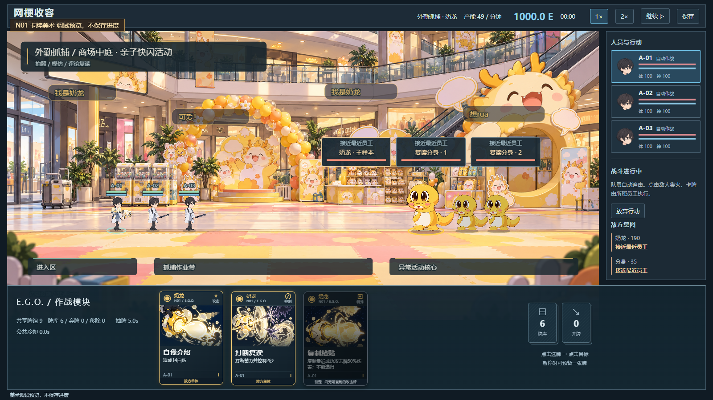
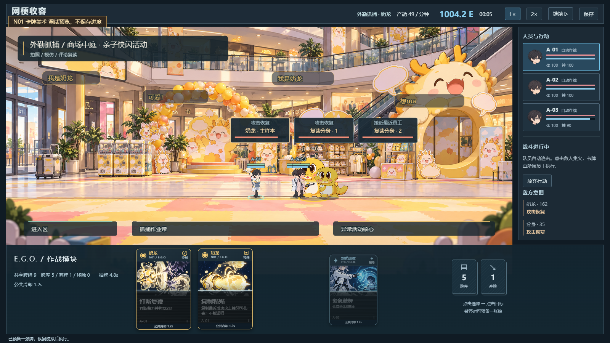
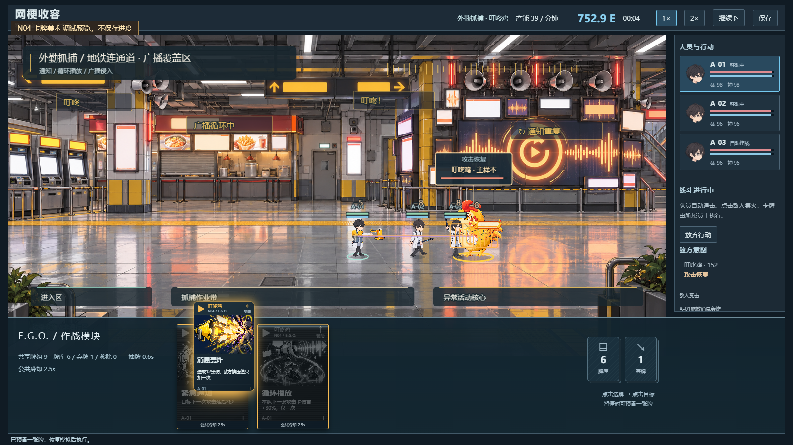

# E.G.O. 卡牌美术 V1｜2026-10-24

## 交付与实现

依据用户附件卡牌方案，按实际配置完成18张独立动作插图（五物各3张＋训练3张），内置imagegen生成，1254×1254 PNG原样导入。总计38,516,532字节。图像不烘焙中文或数值，运行时读取真实卡牌定义。

- 需求Excel：`outputs/cards-v1/网梗收容_EGO卡牌美术需求_V1.xlsx`，三页包括36项素材需求、18条完整提示词、15项状态/动效要求。已实际渲染三页检查，公式错误0。
- 图片：`public/art/cards-v1/`；提示词/逐项来源/尺寸/SHA256：`art-production/cards-v1/`。
- 144×212竖卡，来源、类型、动作插图、机制、员工归属同卡呈现。卡框、来源符号、类型角标和动效为程序绘制；五物命中贴图部分复用已有生成素材，未冒称全部为新生图。
- 稳定DOM避免每帧刷新丢失点击；悬停/长按预览，点选后点场内目标，自身/全队直接预备。选牌显示所属员工、射程、合法目标和范围预览。
- 成功CARD事件才触发飞牌、员工连线和主题命中；取消不产生假命中。抽牌、飞牌、弃牌、待机和冷却全部用模拟秒。
- 公共冷却全卡灰化，自上而下恢复颜色，结束闪亮；非冷却不可用状态保留彩色并变暗、显示锁定原因。
- 未改变卡牌定义、伤害、射程、前摇、2.5秒公共冷却或20秒平衡配置。日志仅增加可选展示元数据，存档版本不变。

## 实际验证

| 范围 | 结果与证据 |
|---|---|
| 逻辑回归 | `npm run test` 359项/15文件通过；类型检查和生产构建通过 |
| 旧配置 | 760设计断言、20公式测试通过，仅属静态/公式证据 |
| 全18素材 | 六组明确标记的DEV预览，54检查/30真实截图，18图实际解码1254×1254，0页面/HTTP错误 |
| 六组施牌 | 原生点牌→点敌人→恢复→员工真实接近→成功CARD与专属特效；无注入时间/伤害，状态与画面一致 |
| 暂停 | 状态、场景和完整截图600ms一致；HUD另验证飞牌/冷却暂停500ms一致 |
| 冷却 | 灰层恢复2%→52%，真实截图显示上半彩色下半灰色；选牌归属与稳定DOM通过 |
| 布局 | 1600×900、1280×720，卡牌无越界，场内小人不被手牌遮住 |
| 存档隔离 | 六组预览无Storage调用，哨兵保持；生产包忽略两类美术预览参数 |
| 生产黑盒 | 正常设施→装备→主动挑战→暂停800ms完整画面一致→刷新放弃；经典入口保留 |

本地完整证据（Git忽略）：

- `docs/gameplay-v03-evidence/cards-art-2026-10-23T16-15-01.096Z/report.json`
- `docs/gameplay-v03-evidence/card-hud-2026-10-23T16-17-05.880Z/report.json`
- `docs/gameplay-v03-evidence/production-2026-10-23T16-25-04.532Z/report.json`

代表真实截图：

## 复验与边界

运行 `npm run dev -- --port 4173`，使用 `node scripts/gameplay-v03-cards-art-proof.mjs` 和 `node scripts/gameplay-v03-card-hud-proof.mjs`。生产预览4174使用 `node scripts/gameplay-v03-production-smoke.mjs`。

DEV `?cardArtPreview=T` 或 `N01`—`N05`提供明确标记、不访问存档的美术预览。初始装备、解锁和抽牌顺序是测试夹具，后续操作走真实引擎；这不是五物正常进度全通关证据。18图全部展示、每组第一张共6张实际施放，其余效果由既有逻辑回归覆盖，本轮未逐张浏览器施放全部18种。

本版采用点击选牌再点目标，未做拖拽施牌；没有新增音效。未验证真实触屏设备、慢网、跨浏览器与长期性能。现有帧绘制和生成素材完整不等于整款游戏所有验收已完成。
