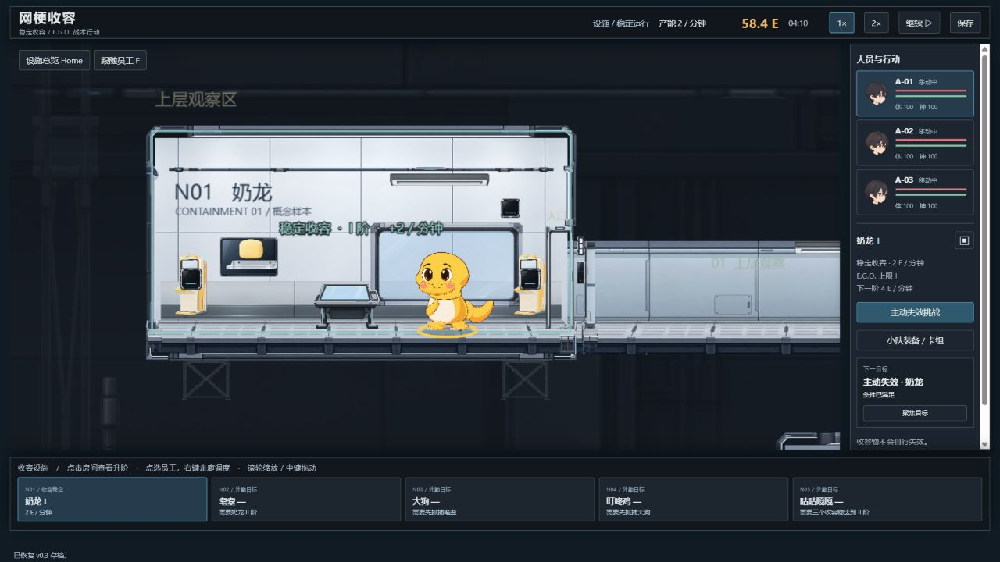
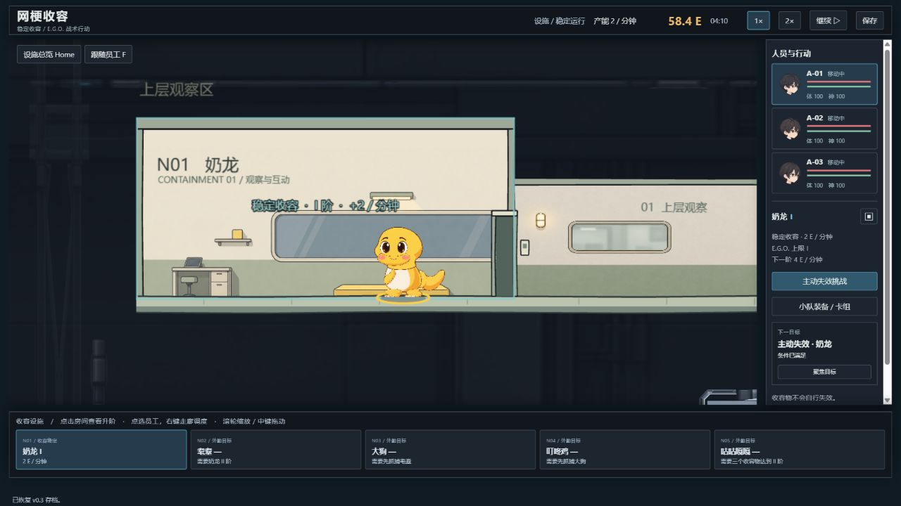
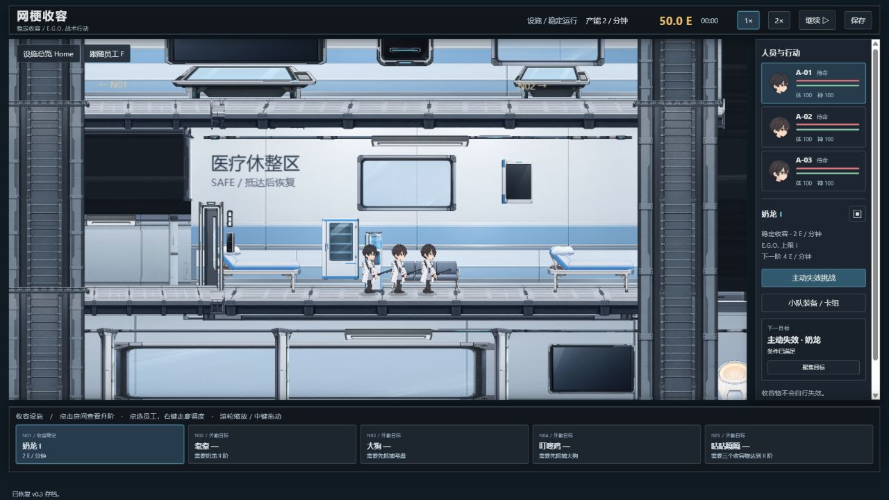
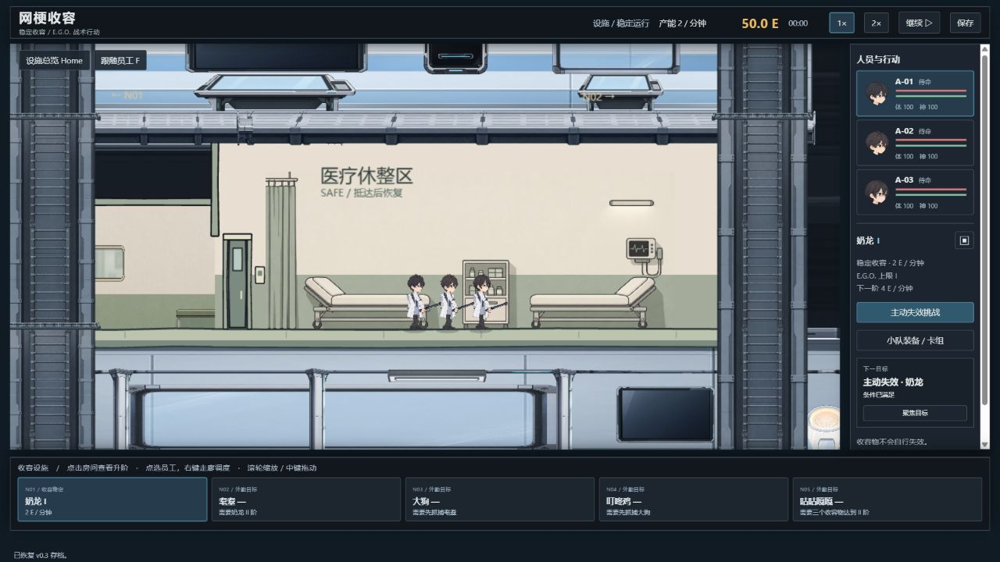
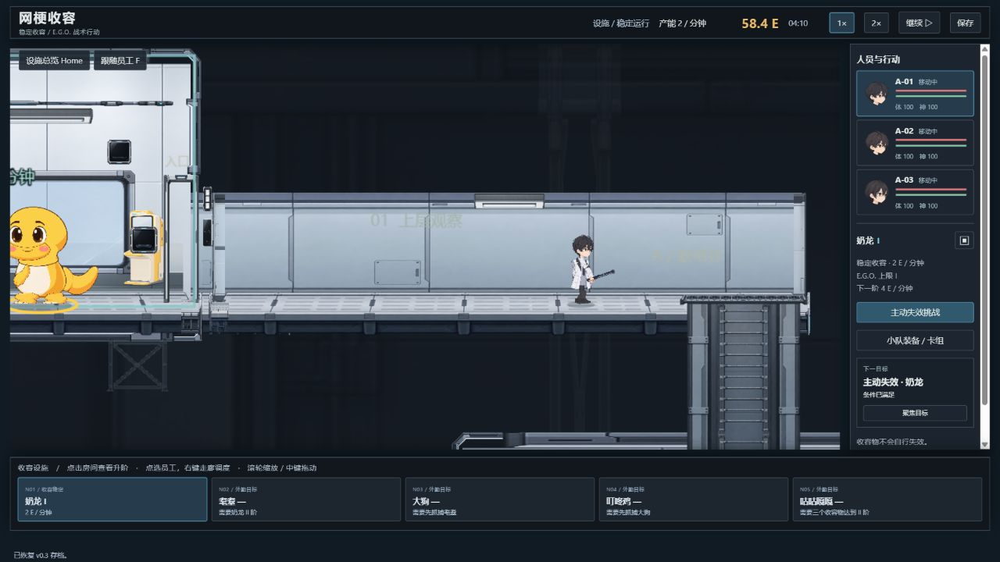
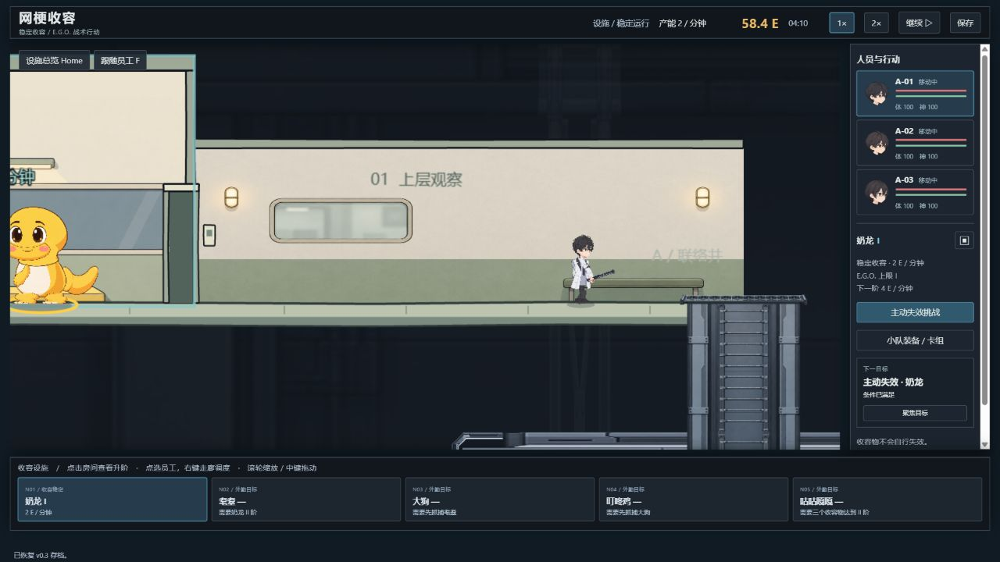
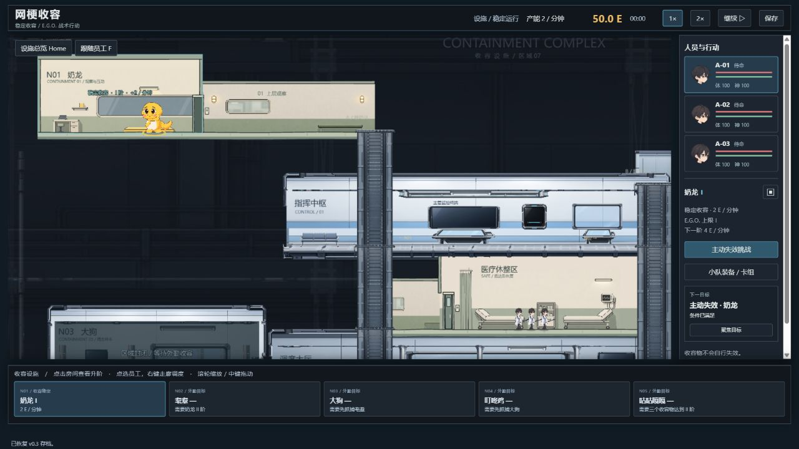

# v0.5 基地环境样板：实装与运行记录

日期：2026-10-25。范围仅奶龙收容室、医疗休憩区和连接走廊，包含 SAFE 入口接缝。其余房间保留原资源。以下截图来自本地游戏实际运行，不是生图生成的实机概念图。

## 完成内容

重新生成并接入三张现代手绘墙面/道具素材；统一结构描边、平涂材质、有限明暗与家具尺度。样板范围内停止绘制旧工业壳体、设备、灯和桥面，再由新结构层绘制真实脚线上的地板、房框与独立门叶。员工、奶龙、空间节点和操作仍使用已有实际游戏状态，没有另做预设角色动画。

本记录取代之前“内墙叠图已经完成”的临时描述。历史 `before-baseline-2026-10-20.png` 属于更早场景，不作为本次同镜头基线；旧的医疗/走廊总览也不作为独立区域验收图。原文件保留备查。

## 三组实际画面对比

每一组使用相同固定镜头、画幅及暂停状态，仅在 DEV 环境切换旧环境绘制 `facilityArt=legacy` 与最终样板。N01 和走廊使用设施时间 04:10、可用能量 58.4 的同一状态；医疗区另用时间 00:00 的新开局同状态进行比例对照，包含 SAFE 中的三名真实员工。不同区域截图不应被解释为连续推进的一局。

正式截图位于 `docs/art-style-v05/facility-slice-review/`；可直接打开 [前后对比浏览页](art-style-v05/facility-slice-review/comparison.html)。完整操作过程另保存在本地 `docs/facility-v05-evidence/final/`。

### 奶龙收容室

旧环境：

新样板：

检查重点：机械壳体和密集金属细节替换为暖白墙、平涂观察窗和明确终端；奶龙是场内实时实体。地板与 `y=460` 真实脚线对齐，门仍使用原节点与状态。

### 医疗休憩区

旧环境：

新样板：

检查重点：通过员工与床、药柜的同画面对照确认比例；家具墙图等比缩放，周边留白补齐，避免把全部设备拉到房高。床靠背约 69 world px，接近 66 world px 员工基准。原写实医疗灯和设备不再穿出新墙图。

### 连接走廊

旧环境：

新样板：

检查重点：统一护墙带、低对比观察窗、长椅和地板；去除旧图地面落在脚线以下导致的悬浮感。N01 门侧到联络井保留连续可行走带，联络井与范围外结构仍使用原资产，未批量重绘。

## 三处整合实机图

这是设施时间 04:30 的整合状态。三个区域与现有员工、奶龙处于同一实际设施场景。该图用于检查统一色板、材料和视觉重心，也明确显示样板与尚未替换区域的边界；区域比例判断仍以前面的聚焦图为准。

这张补充整合图为 00:00 的新开局状态，用于确认三个真实员工与医疗家具及周围设施的关系。不是从上一张截图接续的移动过程。最终风格是否符合预期，仍需用户对这套样板作视觉判断，自动测试不能代替这一判断。

## 连续操作记录

以下证据位于 `docs/facility-v05-evidence/final/`，均来自实际操作；未注入假的移动或门动画。

| 证据 | 操作和观察 | 可证明范围 |
| --- | --- | --- |
| `move-00.jpg` 至 `move-15.jpg` | 员工沿已有通路与联络井持续接近目标，记录约 16 秒过程 | 新背景没有代替实体行走；通路显示与真实移动叠合 |
| `08-moving-left.jpg` | 员工在走廊向左行走 | 移动中存在可操作实体 |
| `09-new-order-paused.jpg` | 暂停并下达新方向命令 | 暂停时可改令 |
| `10-freeze-2sec.jpg` | 等待约 2 秒，样板员工位置保持不动 | 暂停冻结该员工移动；不把细小页面变化误写成整页像素一致 |
| `11-direction-reversed.jpg` | 恢复后员工改变行进方向 | 新命令由真实移动状态执行 |

### 运行检查中发现的既有限制

V3 `moveEmployee` 经 `corridorAt` 判断目标，当前直接点击 SAFE 或 ROOM 内部不会像走廊目标一样接受移动，虽然场景层会高亮 SAFE。此问题位于既有操作/模拟逻辑，本轮按“不改玩法和寻路”的范围保留并记录。没有因此宣称完成“直接点击返回医疗区”或“进室开始工作”的实机验证；医疗区人物比例使用新开局时实际位于 SAFE 的员工检查。

这不是根据新背景推断出的移动回归，也不应把背景门的视觉开合当作工作或恢复结算证据。本轮证据覆盖实际走廊行走、改令、暂停与恢复及样板视觉，未覆盖所有空间行为闭环。

## 检查结果与未验证项

| 检查 | 结果 |
| --- | --- |
| `npm run typecheck` | 通过 |
| `npm run test` | 18 个测试文件、372 项通过 |
| `npm run build` | 通过；保留 Phaser 大 chunk 提示 |
| 正式构建浏览器运行 | `http://127.0.0.1:5192/` 真实加载新样板与三名员工，暂停按钮有效，捕获到的控制台 error 为 0；截图 `production.jpg` |
| 设计配置校验 | 760 项断言通过 |
| Python 公式例算 | 20 项通过 |
| 三处真实同镜头对比与整合 | 已保存上述 JPG |
| 走廊实际移动、途中改令、暂停等待与恢复 | 已操作并保留连续证据 |
| 直接点选医疗区返程、进入 N01 后开始工作 | 本轮未验证；既有目标判断限制如上 |
| 五物战斗、E.G.O.、正式三日流程及存档全矩阵 | 本轮未重新逐项实机验证，不以自动测试替代 |
| 触屏、长期性能、跨设备与全部分辨率 | 未验证 |
| N02–N05 以及其他房间批量替换 | 未执行，待样板验收后再扩展 |

素材、规范和证据保存在本地工作区。正式对比图与浏览页放在可随仓库交付的 `docs/art-style-v05/facility-slice-review/`；完整操作证据目录受 Git 忽略规则影响，只保证本地留存。本记录不代表已提交或推送。

最终素材路径和尺度见 [切片规范](FACILITY_V05_SLICE_SPEC.md)，后续墙、地板、门、灯、设备与装饰复用见 [组件规范](FACILITY_V05_COMPONENT_RULES.md)。
