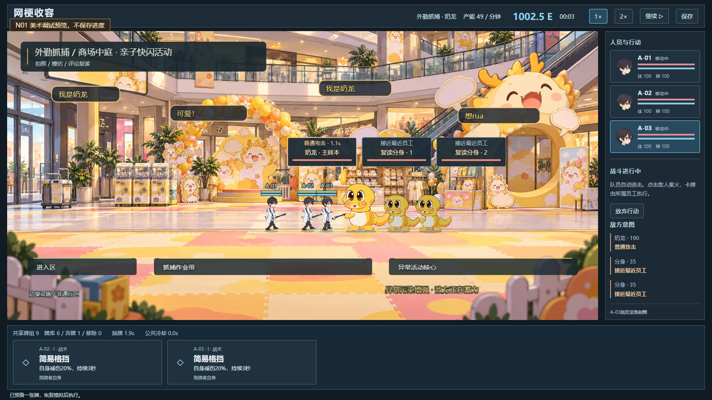
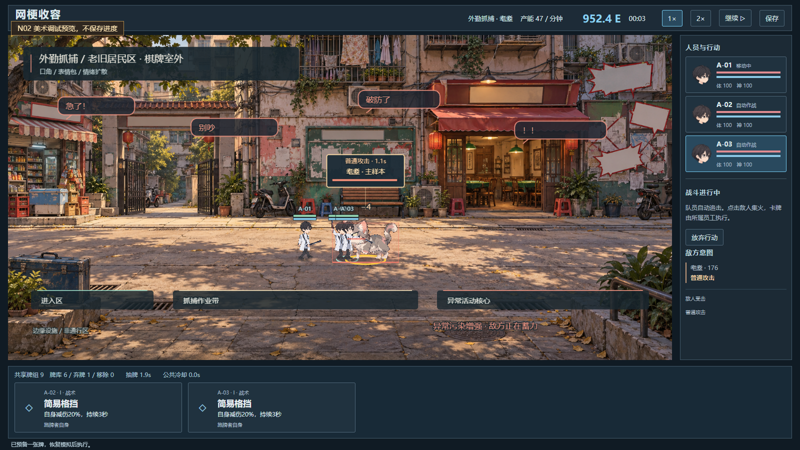
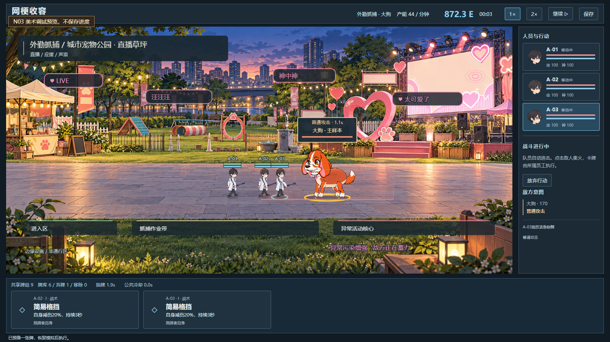
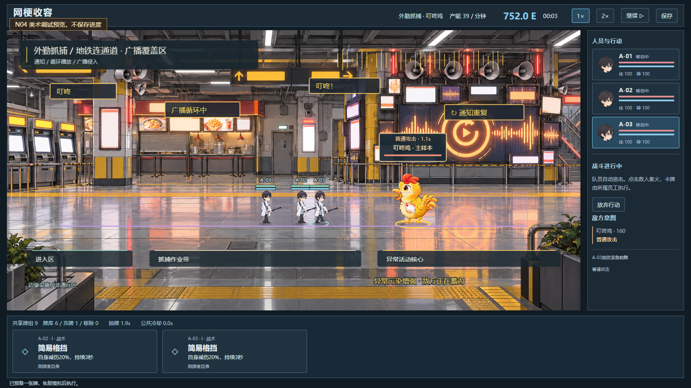
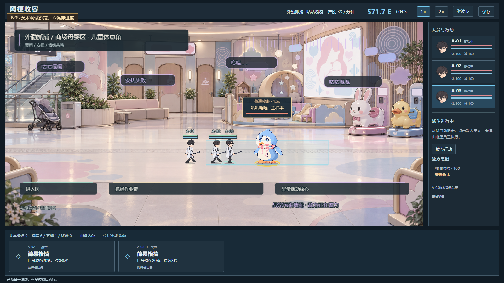

# 外勤场景美术 v1 实装验收｜2026-10-23

用户要求外勤从设施白墙改为“收容物活跃的现实环境＋模因污染”。本轮生成五张独立1774×887横版PNG并接入CAPTURE；原设施与室内主动失效挑战保持原场景，战斗数值不改。

## 资源与实现

| 对象 | 地点 / 主视觉 | 独立污染表现 |
|---|---|---|
| 奶龙 | 商场亲子快闪 / 气球与打卡装置 | 暖黄复读评论、我是奶龙、可爱气泡 |
| 耄耋 | 旧社区 / 棋牌室和公告栏 | 红边争吵气泡、急了、破防了、别吵 |
| 大狗 | 宠物广场 / 直播大屏与爱心装置 | LIVE、爱心、应援评论与声波环 |
| 叮咚鸡 | 地铁连通道 / 喇叭和广播屏墙 | 叮咚通知、循环提示、动态波形 |
| 咕咕嘎嘎 | 母婴儿童角 / 安抚灯箱和摇摇车 | 安抚失败、拟声气泡、柔色噪声波纹 |

生成使用内置image_gen，完整提示词在 `art-production/field-v1/prompts.json`。PNG实际保存在 `public/art/field-v1/`，索引/尺寸/哈希在 `art-production/field-v1/manifest.json`。原始图片不含真实员工、敌人或战斗UI，不是伪造实机图。

`FieldArt.ts`负责独立背景与污染，`Scene.ts`仅在CAPTURE按对象切换。主路径保持原坐标与碰撞：左进入、中作业、右核心；前景边缘道具为非通行装饰；动态危险区仍取实际敌人射程/蓄力。污染强弱读取真实WINDUP状态，全部动画使用模拟时间，不使用墙钟或动画回调结算。

## 五图调试实机验收

`scripts/gameplay-v03-field-art-proof.mjs`最终PASS：
`docs/gameplay-v03-evidence/field-art-2026-10-23T14-14-15.981Z/report.json`。

- 五个明确标注的DEV美术fixture，45检查、20真实截图。
- 每图真实选牌、选目标、员工移动、成功施牌，真实敌人进入蓄力。
- 蓄力污染增强时暂停600毫秒，完整模拟与渲染状态（角色和污染）保持一致。
- 五图主题/纹理正确加载，0脚本/HTTP错误；已逐图目视角色落地、主视觉和信息层。
- 预览不读取或写入Storage，包括刷新/pagehide；全程访问记录为0，原哨兵值保持。
- 初版35检查通过；补蓄力验证时曾因开发热重载丢失执行环境失败，原FAIL保留，最终完整45检查重新通过。

DEV入口为 `?fieldPreview=N01`至`N05`，使用独立初始解锁/钱包fixture，再由真实CAPTURE API创建战斗，默认暂停，不保存进度。入口和画面明确标识。这些截图不能冒充五物正常进度抓捕通关，尤其奶龙开局已收容，本轮没有增加重复抓捕入口。

## 正常进度连续实玩

`scripts/gameplay-v03-proof.mjs`：
`docs/gameplay-v03-evidence/run-2026-10-23T14-17-47.136Z/report.json`。

通过真实鼠标/键盘从新进度配置装备，1×奶龙17.0秒挑战胜利升II→回设施/装备升级→支付50E外勤耄耋→15.0秒成功抓捕→回设施总产能7E/分钟。耄耋在**新旧社区场景**实际移动、出牌、打断、受击；奶龙挑战保持室内，返回设施外勤背景隐藏。记录的field状态分别为null、N02/loaded=true、null。含连续录像、逐次输入和截图，无伤害/钱包/时间注入。

## 检查与限制

- `npm run typecheck`通过，14文件352测试通过，`npm run build`通过；保留Phaser大包提示。
- 生产包黑盒真实UI检查包含默认设施、战斗、暂停800毫秒整帧一致、继续、刷新放弃、1280布局、经典入口，及忽略DEV预览query。报告在 `docs/gameplay-v03-evidence/production-2026-10-23T14-25-51.968Z/report.json`。
- 本版为五张静态现实场景＋模拟驱动污染，未拆分可编辑PSD/多层场景、没有上下平台新玩法或新障碍碰撞；道具位于通道边缘/后侧。
- 后三物正常进度尚未连续解锁并全部抓捕通关；本轮五图的战斗输入/暂停证明来自明确标记fixture。未宣称移动设备与长期性能通过。
- 五个大PNG约13.16MB，当前随场景预载；本机正常加载，未验证慢网首屏表现。

## 代表截图

以下均为真实运行截屏，未补画或生成截图：

正常进度抓捕截图与完整证据索引见 `showcase/field-v1-verification-summary.json`。
