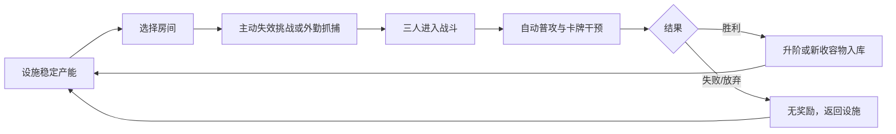

# 《网梗收容：奶龙失效》游戏流程书｜v0.3

版本：v0.3 实时设施与 E.G.O. 卡牌主线  
更新：2026-10-24  
适用入口：默认 `/`  
实现载体：Phaser 2D 设施场景 + TypeScript 固定步模拟

这份流程书描述玩家实际看到和操作的流程，也记录本轮在真实 Chrome 中跑过的路径。默认 v0.3 主线与旧经典三日入口是两套流程，不能混为同一套系统。

## 一、默认主线的目标和边界

默认入口是一条可重复的设施经营与实时战斗循环：

默认 v0.3 开局是 **N01 奶龙 I 阶已收容、50 E、3 名员工**。战斗固定派出前三名员工；一名员工装备一套武器/防具。默认主线不包含三日结算、旧主管技能和正式日1四员工编制；三日流程在文末的 `?mode=campaign` 经典入口中单独说明。

## 二、启动与设施待机

打开 `npm run dev` 提供的 `http://127.0.0.1:4173/`，画面主体是设施剖面：收容室、走廊、设备、员工和收容物实体同时可见。右侧是人员与行动辅助栏，底部是房间操作和战斗卡牌区。

待机状态的玩家操作：

| 操作 | 结果 |
|---|---|
| 点击场内员工 | 选择员工，脚底出现选中反馈；右侧显示状态 |
| Shift 点选/框选 | 多选员工，继续在场景中发出移动命令 |
| 右键走廊 | 员工沿真实设施路径移动，途中可暂停后改令 |
| Home | 回到设施总览 |
| F | 镜头跟随当前员工 |
| 滚轮/Alt拖动 | 缩放或移动设施视图 |
| 空格 | 暂停/继续模拟 |

空闲员工会沿设施通路散步。稳定设施会持续产生可用能量；主动暂停时不推进模拟，也不结算离线收益。

### 2.1 收容物档案页

在当前房间标题旁点击 `▣` 档案入口，打开独立的收容物档案页。该页是辅助信息页，不替代设施主画面；关闭后回到同一房间和同一模拟状态。页面按身份证式左右分栏组织，减少长段落文字：

- 左栏显示收容物头像、编号、收容/未收容状态、LIVE/LOCKED 状态、收容等级、产能与上限。
- 右栏以图标化模块显示行为档案、失效须知、E.G.O. 装备上限及关联武器、防具、技能。
- 档案页读取当前真实收容状态；切换或关闭不会创建另一份状态，也不会绕过房间、工作或战斗规则。
- 小队装备与卡组仍位于主设施右侧行动栏，档案页只提供关联装备的识别与上限信息。

## 三、装备与卡组准备

点击“装备/小队装备”打开配置面板。打开面板会自动暂停；关闭面板后仍保持暂停，必须点击“继续”或按空格（模态框已经关闭后）恢复。模态框打开时按空格不会让背后的移动或战斗继续。

首轮推荐操作：

1. 给 E01 装备奶龙武器 W01 与防具 A01。
2. 点击确认装备，再关闭面板。
3. 下一场战斗会生成 9 张共享牌，每名出战员工拥有 3 张，开场抽 3 张，上限 4 张，每 5 个模拟秒抽一张。

卡牌不是远程结算按钮。点击卡牌后，场内会显示持卡员工、合法目标、射程带和范围预览；确认目标后，员工走到射程内，经过真实前摇才产生 CARD 事件和效果。

对需要单体目标的 ENEMY / ALLY 卡，选牌后会从持卡员工向鼠标当前指向绘制实时箭头。鼠标移到合法目标时箭头吸附到该角色并高亮；移到空白处时箭头跟随鼠标、降低透明度，只作为瞄准提示，点击空白处不会施法。SELF / TEAM 卡不显示单体指向箭头。

## 四、奶龙主动失效挑战

### 4.1 发起挑战

点击奶龙房间，再点击“主动失效挑战”，确认后：

- N01 房间进入 `IN_CHALLENGE`，该物停止产能。
- 三名员工从设施位置走向战斗区。
- 主样本和两名分身成为独立场内实体。
- 卡组进入 3 张手牌、6 张牌库的真实状态。

挑战确认弹窗打开时模拟保持暂停；确认后可以继续暂停检查，也可以恢复 1×/2×运行。

### 4.2 战斗中玩家做什么

员工会自动接敌和普通攻击。玩家可以：

1. 点击敌人或场内引线标签，使员工集火。
2. 点击一张可用牌，再点击场内敌人或员工。
3. 对自身牌/全队牌直接预备，恢复后由真实持卡员工执行。
4. 空格暂停，在暂停期间改变目标或预备一张牌。
5. 让员工撤退；撤退会停止追击并沿通路返回安全位置。

每张牌成功施放后进入 2.5 秒公共冷却：整张卡变灰，再从顶部到底部逐步恢复颜色。冷却中的卡与无合法目标的暗色不可用状态有明确区别。

### 4.3 奶龙结果

本轮真实流程记录：

- 卡牌施放后，持卡员工实际移动、前摇、命中；没有后台按钮扣血。
- 1× 模拟约 16.95 秒击败奶龙主样本，N01 I 阶升为 II 阶。
- 胜利结果会在战斗画面短暂停留约 1.25 个模拟秒，随后在未暂停时自动结算并返回设施；员工沿真实通路回到安全位置，`encounter` 清空，N01 恢复稳定产能。暂停期间结果不会倒计时，玩家可查看结果或修改命令；恢复后才继续自动返回计时。
- “立即返回设施”仍保留为手动兜底入口。自动返回与手动返回走同一 `finishEncounter()` 结算路径，不额外发奖励或扣除资源。
- 装备面板可显式把 E01 的 W01/A01 升到 II 阶。

## 五、耄耋外勤抓捕

N02 抓捕需要已收容奶龙并支付 50 E。操作顺序：

1. 回到设施后等待或运行稳定产能，确认钱包足够。
2. 点击耄耋房间，再点击“外勤抓捕/捕获”。
3. 确认后立即扣除 50 E，N02 进入外勤战斗并停止产能。
4. 三名员工进入真实战斗区；耄耋目标会保持当前走廊目标，只有目标撤退到安全区或失效时才重新选择。
5. 员工走近、普攻、施牌和打断蓄力均在同一模拟状态中发生。

本轮真实流程约 13.95 模拟秒完成耄耋抓捕。胜利后 N02 变为 I 阶稳定收容，并解锁 W02/A02；结果短暂停留后自动返回设施，员工回到安全位置，新房间开始产能。抓捕失败或刷新退出不会退还入场费用。

## 六、失败、暂停、刷新和存档

| 情况 | 玩家看到的结果 |
|---|---|
| 暂停 | 移动、作业、攻击、前摇、卡牌飞行和冷却全部冻结；可改命令 |
| 战斗失败 | 无升阶、无新装备，员工伤害/精神状态保留，结果结算后自动返回设施 |
| 点击放弃 | 战斗无奖励，房间恢复原收容状态 |
| 战斗中刷新/关闭标签页 | 按放弃处理，不发奖励，不结算离线收益；入场费用不退 |
| 稳定设施关闭后重开 | 根据保存时间结算离线收益，最多 2 小时；主动暂停不结算 |
| 卡牌成功施放后自动保存 | CARD 事件及插画坐标元数据一并保存，刷新不会回退到施牌前 |
| 存档格式错误 | 显示阻断信息，保留原文，不覆盖旧存档 |

战斗保存是安全边界记录，不能用刷新恢复战斗本身；刷新会将战斗转为放弃。

## 七、旧经典三日入口

通过 `?mode=campaign` 或旧经典入口进入三日值班流程。该入口保留原来的四员工第一日、日指标、工作派遣和日结逻辑，与默认 v0.3 的三员工实时卡牌主线分开维护。

流程书不把经典模式的四员工/三日指标写成默认 v0.3 的行为。`?classic=1` 是原大型演练入口；`?slice=1` 是旧单室调试入口。

## 八、本轮优化记录

本轮从真实流程发现并修复：

1. **卡牌事件自动存档失败**：严格存档 schema 漏掉 `cardId`、`instanceId`、`sourcePoint`、`targetPoint`，施牌后约 5 秒会弹出存档格式错误。现已纳入 schema，并用真实浏览器确认自动保存后的 CARD 事件可读。
2. **模态框空格穿透**：装备/挑战/抓捕弹窗打开时，空格原本可能恢复后台模拟。现已拦截，弹窗内模拟继续保持暂停。
3. **耄耋目标抖动**：敌人原本每个模拟步都重新选最近员工。现改为锁定当前活着且仍在走廊的目标，目标撤退或失效后才切换，并用员工 ID 作为距离相同时的稳定排序。
4. **完整流程脚本竞态**：胜利与 DOM 卡牌禁用可能发生在同一帧，脚本原本会误报点击失败。验证脚本现在在点击前重读结果，并把已完成战斗视为正常边界。
5. **战斗结束滞留**：胜利后原流程需要玩家手动点击返回，容易把已经完成的战斗误认为卡住。现改为结果短暂停留后按模拟时间自动回设施；暂停冻结倒计时，恢复后继续执行，保留手动返回兜底。
6. **收容物信息层级**：原信息集中在主界面操作区，档案内容与设施空间混在一起。现增加独立身份证式档案页，将头像、状态、等级、产能、档案、须知和 E.G.O. 上限分栏显示；小队装备与卡组仍留在主界面右侧。

## 九、验证记录

### 已实际运行

- `npm run test`：361 项、15 个测试文件通过。
- `npm run typecheck`：通过。
- `npm run build`：通过。
- `py -3 validation/validate_design.py`：760 项设计断言通过。
- `py -3 -m unittest discover -s validation -p 'test_*.py'`：20 项公式测试通过。
- 默认 v0.3 完整 Chrome 流程：通过。最新报告：`docs/gameplay-v03-evidence/run-2026-10-23T18-56-08.416Z/report.json`。
- 自动返回与档案页真实回归：通过。奶龙自然胜利后约 1.25 模拟秒自动回设施，`encounter` 清空且员工回安全位置；暂停结果时倒计时冻结，恢复后继续。设施房间标题旁 `▣` 可打开身份证式档案页，头像、状态、等级、产能、图标模块与关闭/返回入口可见。
- 自动返回独立证据：`docs/gameplay-v03-evidence/auto-return-2026-10-24T03-50-42.325Z/report.json`，奶龙 16.70 模拟秒获胜后未点击返回按钮，自动回到 `FACILITY`；截图为 `01-entry-paused.png`、`02-victory-result.png`、`03-auto-returned-facility.png`。
- 档案页独立证据：`docs/gameplay-v03-evidence/profile-2026-10-24T03-55-49.898Z/report.json`，覆盖 N01 已收容与 N02 未收容两种状态，以及“返回设施”后右侧小队装备入口仍在。
- 定向卡箭头证据：`docs/gameplay-v03-evidence/card-arrow-2026-10-24T04-06-45.954Z/report.json`，鼠标悬停合法敌人时 `arrowLegal=true` 并吸附目标，移到空白处时箭头端点随鼠标变化且不触发施法。
- 生产包黑盒：通过。最新报告：`docs/gameplay-v03-evidence/production-2026-10-23T18-50-53.006Z/report.json`。
- 保存/刷新、离线收益、外勤五图、18 张卡牌素材与卡牌 HUD：对应报告均已保存在 `docs/gameplay-v03-evidence/`。

### 默认主线的真实操作记录

| 顺序 | 实际操作 | 结果 |
|---:|---|---|
| 1 | 进入设施并暂停 | 3 名员工、N01 I 阶、5 个房间可见 |
| 2 | E01 装备 W01/A01 | 生成 9 张真实归属卡 |
| 3 | 打开挑战弹窗并在弹窗内按空格 | 时间仍为暂停 |
| 4 | 确认奶龙失效 | 主样本＋2 分身进入战斗区 |
| 5 | 选牌、点目标、恢复模拟 | 员工接近后成功 CARD，冷却出现 |
| 6 | 等待卡牌事件自动保存 | 存档中的 CARD 元数据存在 |
| 7 | 奶龙战斗胜利 | 16.95 模拟秒，升至 II 阶 |
| 8 | 返回设施、升级 E01 | 设备阶级升至 II |
| 9 | 支付 50 E 抓捕耄耋 | 进入外勤战斗 |
| 10 | 耄耋战斗胜利并等待自动结算 | 13.95 模拟秒后自动回设施，N02 I 阶和 W02/A02 解锁 |
| 11 | 再次开始挑战后刷新 | 战斗放弃，无额外奖励 |
| 12 | 缩放 1280×720 | 设施与房间按钮无越界 |
| 13 | 在奶龙房间点击 `▣` 档案 | 独立身份证式页面打开，头像/状态/等级/产能/档案/须知/E.G.O. 上限和关联装备图标可见 |
| 14 | 关闭档案并回到设施 | 回到原房间与原模拟状态，小队装备/卡组仍在右侧主界面 |

## 十、尚未宣称完成的范围

- N03 大狗、N04 叮咚鸡、N05 咕咕嘎嘎的完整正常进度解锁与每个阶级，当前有引擎/调试场景和素材验证，但没有逐一完成正常存档流程。
- 18 张卡牌全部加载并完成六组真实施放抽查；本轮没有逐张把 18 张都在浏览器里施放一遍。
- 经典三日完整值班、全部技能组合、受伤小队全组合、移动端触屏、慢网和长期性能。

这些限制保留在流程书中，避免把卡牌素材验收或调试夹具当成完整内容通关。
