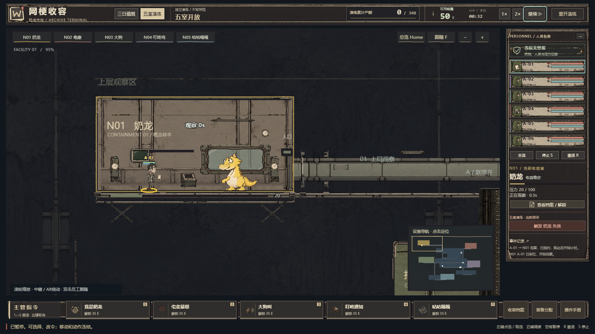
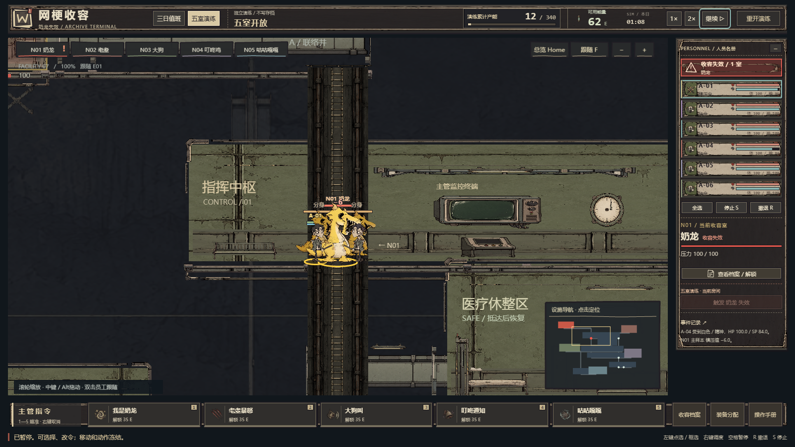
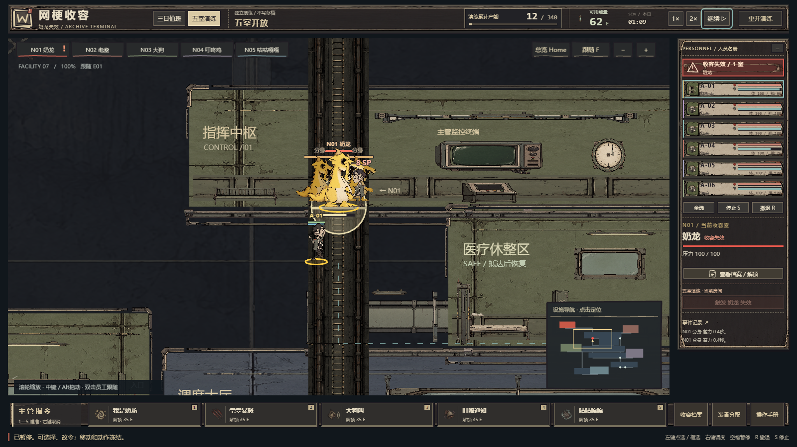

# 生成美术接入与实际验收｜2026-10-21

按用户提供的美术标准和《网梗收容_美术素材生成需求_v1.0_20261021.xlsx》完成本批素材生成，接入现有Phaser设施场景。采用已确认的员工参考风格：怪诞墨线、低饱和工业色、大头细肢、旧档案界面。这里的游戏截图和录像均来自真实Chrome运行；素材检查图另存，不作为实机证据。

## 素材与交付位置

| 分类 | PNG单元 | 实际运行 | 定稿/动作参考 |
|---|---:|---:|---:|
| 员工、发型、表情、五套装备 | 77 | 54 | 23 |
| 五物定稿与拆件 | 68 | 58 | 10 |
| 五物工作/战斗动作参考 | 49 | 0 | 49 |
| 设施、门窗、梯道和设备 | 67 | 67 | 0 |
| UI与状态特效 | 27 | 27 | 0 |
| 合计 | **288** | **206** | **82** |

105组需求已逐项对应，缺失0；其中3组quantity=0按原表保留程序绘制：文字/数值/血条、精确选中/范围/路径/小地图、分身精灵复用。不能为了增加图片数量替换这些实际规则提示。

- [完整索引CSV](../art-production/production-index.csv)：命名、需求ID、原图与运行文件对应，可用Excel打开。
- [机器可读索引](../art-production/production-index.json)：288项尺寸、透明通道、SHA256、处理后尺寸和状态。
- [素材交接说明](../art-production/README.md)：目录和处理工具。
- 原图、生成提示与来源：`art-production/generated/`；实际加载的素材：`public/art/generated/`。
- 部分定稿另有public预览副本，不在206项运行加载清单中。82张参考用于造型/制作检查，尚未做成逐帧挂点配准的动画sheet。

原始模型输出保持原尺寸留存；实际拆件做有记录的透明边界裁切、等比缩放和部件隔离，握柄/关节在运行骨架中注册。没有把参考图冒充PSD或可直接播放的动画。墙面、井壁和远景底纹本来就需要不透明填充；其他需要抠图的单元具有透明背景。UI_014按备注明确名称使用walk/retreat两个图标，索引同时保留工作表自动名称。

## 接入方式

`HumanRig.ts`读取真实员工位置、移动距离、工作类型、攻击前摇、HP/SP与装备；`CreatureRig.ts`读取真实房间/敌人状态，主样本和分身各自绑定实体。`EnvironmentArt.ts`按现有3600×2500地图放置67个模块，门根据实际通行/工作状态显示。`EffectsArt.ts`接收真实命中、恐慌、工作和失效事件，时间来自模拟秒。

场内人物保留头、躯干、四肢、制服、武器和动作；字、进度条填充、碰撞、射程和选中路径继续精确绘制。员工在异常前层显示，重叠交战时仍能看清身体与手持武器。默认演练与正式三日共用新素材；`?slice=1`继续保留旧程序画法。

## 实际操作证据

| 专项 | 结果 | 原始报告 |
|---|---|---|
| 连续操作、五物平静/失效、档案、1280布局 | PASS；63次原生输入、8检查点、19截图；四类浏览器错误0 | [最终连续记录](generated-art-evidence-2026-10-21/run-2026-10-21T08-30-53.802Z/report.json) |
| 六发型、真实恐慌和重伤 | PASS；3案例、5检查点、499只读采样；四类浏览器错误和采样错误均0 | [人员记录](generated-art-evidence-2026-10-21/personnel/2026-10-21T08-28-05.813Z/suite.json) |
| 五套装备实际生产、购买、穿戴 | PASS；176次原生输入、5检查点 | [装备记录](generated-art-evidence-2026-10-21/equipment-2026-10-21T07-55-19.939Z/report.json) |
| 生产包镜头、移动、暂停、两种尺寸、正式第一日 | PASS；15检查点；页面/控制台/HTTP/失败请求/外部资源/开发资源错误均0 | [生产包记录](generated-art-evidence-2026-10-21/production-2026-10-21T08-35-20.926Z/report.json) |

装备专项通过四轮五室观察实际生产272能量，钱包50→322；按原价购买五物行为情报与五套装备后剩37，全部实际穿戴并移动。该脚本监测页面错误与HTTP错误，均0；没有监测控制台和请求失败，不能把其覆盖扩大为四类错误全0。此后发型定向修订由人员专项重新检查；人员专项后只调整了员工/异常绘制前后顺序，最终连续链和生产包再次检查了显示结果。

### 一次连续操作的实际模拟时间

| 时间 | 操作与实际结果 |
|---:|---|
| 1.25秒 | 点击场内员工并移动；途中暂停，改成另一目的地，位置和模拟钟冻结 |
| 13.75秒 | 恢复后到达修改后的目标，停止并重新派工 |
| 32.10秒 | 员工已走入奶龙收容室，到达工作位；TRAVELLING变为EXECUTING，才开始计时 |
| 56.15秒 | 实际完成观察产能+12，钱包62；随后触发失效，生成1主样本+2分身 |
| 68.50秒 | 右键场内主样本，下达SUPPRESS；沿实际路径追到同一走廊后命中，主样本HP180→174 |
| 69.50秒 | 暂停时改成RETREAT，恢复后已沿楼梯撤离超过80世界单位；累计产能和钱包仍为12/62 |

随后通过原生重新演练按钮逐一查看其余四物平静/失效及档案界面。未写入模拟状态、注入资源或改时钟；2倍速来自实际游戏按钮。真实演练允许触发失效，正式值班没有此按钮。

[连续WebM录像](generated-art-evidence-2026-10-21/run-2026-10-21T08-30-53.802Z/video/page@79d4369f31e4f1035594aa4f69684a11.webm)为**60.84秒、1600×900、25fps、1521帧**。已实际解码并查看六处帧，覆盖改令、接近工作位、工作中、失效、交战/撤退及后续其他收容物；[解码记录](generated-art-evidence-2026-10-21/run-2026-10-21T08-30-53.802Z/video-inspection.json)保留原帧位置。

暂停期间移动、工作、攻击与生成骨架/特效状态比较不变；允许改令且恢复后执行。生产包另在700毫秒等待前后比较设施截图，**956,160像素全部相同、模拟钟不变**。六发型分散站位、恐慌SP=0后的实际撤离、HP=0后的实际倒地均已查看。正式第一日准备与开始时均为4名员工。

## 代表截图

以下为原截图直接复制，来源与SHA256见[交付摘要](showcase/generated-verification-summary.json)，不是图像模型生成的场景。

更多截图见[展示目录](showcase/README.md)。

## 修复与失败留存

第一次和第二次连续测试在镇压阶段超时，原报告与录像保留在`run-2026-10-21T07-54-06.200Z`、`run-2026-10-21T07-57-51.719Z`。定位到两条真实空间问题：追第三人的敌人被会合点反复拉回梯口，导致员工前摇无法命中；事故中断自动闲逛时，E04被清空路径而滞留梯井。

最小修复为：只在真正互追时设置平台会合；追第三人和巡逻继续原路线。失效中断自动闲逛时，已在梯井的员工沿真实通路走到最近平台，暂停冻结、玩家命令可覆盖；走廊立即停。没有改选敌锁定、伤害、前摇、地图或经济，也没有允许梯间/隔楼板攻击。新增11项回归；[旧代码失败与修复日志](generated-art-evidence-2026-10-21/navigation-fix/)保留。

修复后`08-26-20.730Z`连续测试通过；查看后调整人物前后显示层级，再次完整运行得到最终`08-30-53.802Z`通过记录。

生产检查首次`production-2026-10-21T08-33-21.592Z`的15个操作点已通过，但网络分类把Phaser解码本地PNG产生的374个同源blob URL误判为外网而整体FAIL。修正为校验blob的实际origin，外部blob和仿冒前缀仍拒绝；游戏文件未变，再跑得到最终PASS。原FAIL保留，未改写历史结果。

## 静态验证与保留范围

- `npm run typecheck`通过；`npm run test`为8文件153项通过；`npm run build`通过，仅保留既有Phaser大包提示。最终显示层调整后再次typecheck/build通过。
- `py -3 validation/validate_design.py`：760断言通过；公式例算20项通过。它们不代替上述实机证据。
- 配置、合同、数据加载和存档模块未改动；保留本轮开始前的用户改动、旧源码、旧美术与历史验收文件。没有清空工程或回退文件。
- 只对本次实测暴露的两条空间死锁修复模拟代码；其余为素材、显示层、测试证据与文档。

完整三日流程、本轮全部技能组合、五把武器各自的攻击动画、其他设备和长期性能**未重跑**。五套装备的本轮证据覆盖购买/穿戴/站立/移动；普通制式武器完成了连续战斗验证。参考姿势不是动画sheet，当前没有PSD分层源文件、配音或音乐，也不宣称商业美术终稿。

## 本地试玩与复验

本轮通过检查的生产包在[4174试玩](http://127.0.0.1:4174/)，原4173开发预览保留。均为本机服务；关闭服务或重启后，可按项目README通过`Start-Game.cmd`重新构建启动默认4173。

复验命令见[README](../README.md)。生产烟测现在支持`FACILITY_URL`选择独立预览端口，默认仍4173；例如本轮使用`http://127.0.0.1:4174/`。完整原始证据在本机`docs/generated-art-evidence-2026-10-21/`，展示目录保存13张无改动截图及来源哈希，旧证据全部保留。
