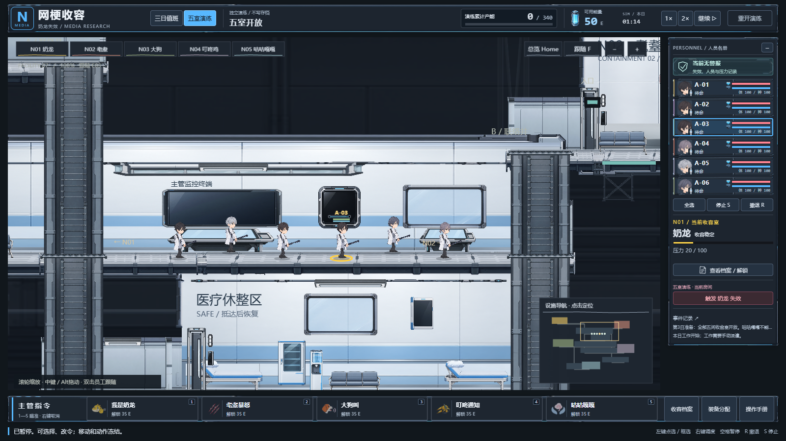
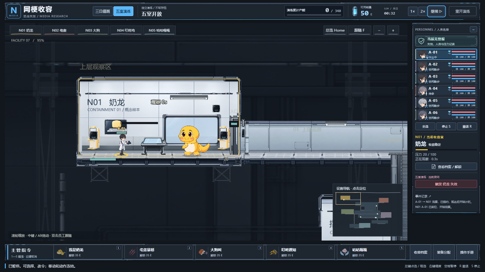

# 员工形象 v3：按用户参考图重新制作｜2026-10-23

本轮针对“人物和参考图不相似”的反馈，只修订员工美术与名单头像。参考图中的柔和动漫脸型、自然刘海、浅色研究员长外套、深色裤鞋是此次依据；没有把图中的六种异常、科研或其他系统加入玩法。

## 实现与素材

- 以完整头部替代旧头、脸、头发多层拼装，避免额头、眼睛和刘海错位。六人分别使用黑发、棕发、眼镜短发、灰紫低马尾、银灰发、蓝灰盘发。
- 默认员工统一白色研究员外套，深色领口、浅蓝内衬、深色长裤和黑鞋。调整头身比例、肩腰位置、衣摆长度及四肢宽度。五套实际装备仍按原装备状态叠加。
- 名单使用同一员工的头部素材，同时保留工作、移动、恐慌等状态角标。
- 新增12张运行素材：6个头部、外套躯干、上臂、前臂、大腿、小腿、鞋。手、平板、初始武器及五套专属装备沿用v2。
- 使用内置 imagegen 生成/修订，未使用外部API。原图、用户参考和提示在 `art-production/personnel-v3/`；提示集合为 `brief.json`，银灰发定向修订见 `head_e05-revision.json`。首次发色不合格的图片保留为 `head_e05-first-pass.png`。
- 导入脚本 `scripts/personnel-v3-import.py` 保留RGBA，按可见alpha范围裁切、缩放至最大512像素；源图SHA256、裁切范围和运行尺寸见 `import-records.json`。正式素材为 `public/art/personnel-v3/`，加载表为 `src/art/generated/personnel-v3-manifest.json`。
- v2旧素材全部保留。v2的307张清单是历史交付数量，不能将本轮12张替换素材误记成该清单缺口。

## 实际验证

所有操作证据来自真实Chrome页面的鼠标和键盘；开发桥仅读取状态，没有注入资源、命令、时间或动作。生产验证完全不使用开发桥。

| 检查 | 结果及证据 |
|---|---|
| 静态工程 | `npm run typecheck`、`npm run test`（153项/8文件）、`npm run build`通过；保留既有Phaser分包体积提示 |
| 配置与公式 | `py -3 validation/validate_design.py`：760断言；公式20例通过。这些不是实机验证 |
| 连续操作 | 8项检查、63次输入、19张截图；移动途中改令→实际入室工作→收入到账→一主两分身→攻击命中→撤退；浏览器错误0 |
| 人员 | 六人分散站位、真实SP归零后的恐慌撤退、真实HP归零后的倒地，共3案例/5检查点/496采样通过；暂停状态与部件变换冻结 |
| 装备 | 真实工作累计272能量，按原价购入五套装备、穿戴并移动；最终可用37。五套新头身与装备挂点已看图；没有用注入经费替代购买 |
| 生产包 | 4174端口15项通过；正式第一日四人；1280和1600布局无页面溢出；暂停700毫秒，956160像素完全相同；脚本、控制台、HTTP、失败请求均0 |

完整报告目录：

- 连续操作：`docs/personnel-v3-evidence-2026-10-23/run-2026-10-23T10-31-05.949Z/`
- 人员：`docs/personnel-v3-evidence-2026-10-23/personnel/2026-10-23T10-31-05.939Z/`
- 装备：`docs/personnel-v3-evidence-2026-10-23/equipment-2026-10-23T10-33-38.523Z/`
- 生产：`docs/personnel-v3-evidence-2026-10-23/production-2026-10-23T10-33-38.531Z/`

首次人员运行的六人案例检测到启动期页面重复导航，判为FAIL并保留在 `personnel/2026-10-23T10-19-33.661Z/`，不计入通过结果；稳定后的整套复跑通过。未放宽单次导航断言。

仓库可查看的原样截图与SHA256汇总：[人员与动作证据](showcase/personnel-v3-verification-summary.json)。完整视频和原始报告保留在本机证据目录，按仓库原规则不提交。

## 限制

- 当前每人使用一张基础脸；恐慌、受击与倒地依靠真实身体姿态、色调、特效及状态提示表达，尚未制作六人各自的表情替换图。
- 本轮未重跑完整三日、全部技能与五种武器的所有攻击组合、跨设备长期性能。装备验证覆盖购买、穿戴与移动，不代表五种武器攻击逐一验收。
- 默认设施和正式值班使用新版人物；旧 `?slice=1` 回归入口仍是历史画法。
- 本轮代码差异未改玩法数值、导航、存档及模拟逻辑；员工操作继续读取同一实际状态。美术趋近参考的程度仍需用户评估，不以测试通过代替审美确认。
